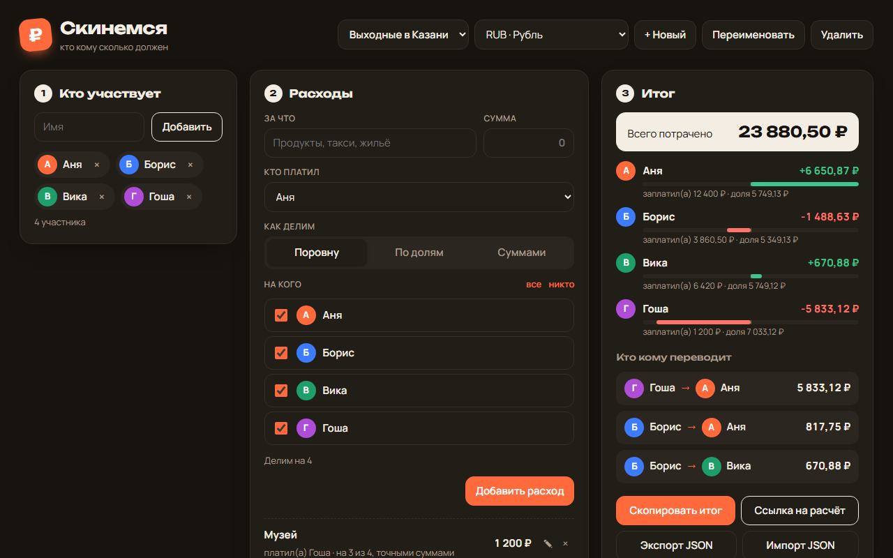

# Скинемся: делим общие расходы

Веб-приложение для поездок, ужинов и съёмных квартир: записываете, кто за что заплатил, а оно считает баланс каждого и выдаёт минимальный список переводов «кто кому сколько». Без регистрации и сервера, итог можно скопировать в чат или отправить ссылкой.



**Открыть:** https://whysafe.github.io/skinemsya/

## Возможности

**Расходы**
- Три способа деления: поровну, по долям (например, 1 и 2: второй платит вдвое больше), точными суммами
- Можно выбрать, на кого делится расход: «все» или только часть компании
- Предпросмотр прямо в форме: сколько с каждого, сколько осталось распределить в режиме сумм
- Суммы вводятся как удобно: `1500`, `1 500`, `349,90`
- Редактирование и удаление любого расхода

**Итог**
- Баланс каждого: сколько заплатил, какая у него доля, сколько ему должны или он должен
- Наглядная полоска баланса: зелёная вправо, красная влево
- Минимальный набор переводов: не больше, чем участников минус один
- Деление без потери копеек: остаток от деления достаётся по методу наибольшего остатка, сумма долей всегда равна сумме расхода

**Поделиться**
- «Скопировать итог»: готовый текст для Telegram или WhatsApp
- «Ссылка на расчёт»: весь расчёт упакован в адрес ссылки, друг открывает его у себя без сервера
- Экспорт и импорт в JSON

**Удобство**
- Несколько расчётов одновременно (поездка, квартира, день рождения), переключение в шапке
- 8 валют: рубль, доллар, евро, тенге, белорусский рубль, лира, лари, драм
- Всё сохраняется в `localStorage`, вкладки синхронизируются между собой
- Нельзя удалить участника, который уже есть в расходах: приложение подскажет, что сначала поправить
- Тёмная тема по системной настройке, адаптивная вёрстка до 375 px

## Стек

HTML5, CSS3 (Grid, custom properties, `prefers-color-scheme`), JavaScript (ES-модули) без библиотек и сборки, `Intl.NumberFormat`, `<dialog>`, `localStorage`. Тесты на `node:test`, GitHub Actions.

## Запуск

ES-модули не загружаются с `file://`, поэтому нужен любой локальный сервер:

```bash
python -m http.server 8000
# затем http://localhost:8000
```

Тесты (Node.js 20+):

```bash
npm test
```

## Структура проекта

```
index.html          # разметка
style.css           # стили, светлая и тёмная тема
app.js              # интерфейс: отрисовка, формы, хранение, ссылки
split.js            # чистая логика расчёта без DOM
tests/split.test.js # тесты логики
```

## Как это устроено

- Все суммы хранятся в копейках целыми числами, поэтому нет ошибок вида `0.1 + 0.2`
- `splitAmount` делит сумму пропорционально весам: сначала округляет вниз, затем раздаёт оставшиеся копейки тем, у кого больше дробная часть
- `settle` сортирует должников и кредиторов по размеру долга и сводит их попарно: самый крупный должник платит самому крупному кредитору
- Ссылка на расчёт содержит JSON в base64url после `#s=`: часть после `#` не уходит на сервер, а при открытии данные проходят ту же проверку `sanitizeEvent`, что и импорт файла
- Пример расчёта «Выходные в Казани» показывается при первом запуске, чтобы сразу было видно, как всё работает

## Лицензия

MIT © 2026 whysafe. Telegram: [@yawhysafe](https://t.me/yawhysafe) · Сайт: [whysafe.ru](https://whysafe.ru)
